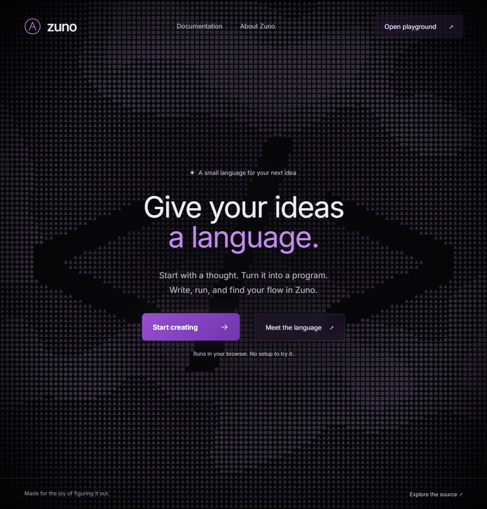

# Zuno

**A small language with room for big ideas.**

Zuno is a programming language you can run in a browser, in your terminal, or from VS Code and Cursor. The syntax has a little personality, but the programs are real: variables, functions, collections, classes, modules, and interactive browser apps run through Zuno's own parser and interpreter.

[Explore Zuno](https://chittranshsharma.github.io/zuno-lang/) · [Language guide](LANGUAGE.md) · [Try the examples](examples/)



## Your first program

```zuno
vibe name = "world";

cook greet(who) {
  yeet "Hello, " + who + "!";
}

yap(greet(name));
```

`vibe` makes a variable, `cook` defines a function, `yeet` returns a value, and `yap` prints it. Prefer familiar words? `let`, `fn`, `return`, and `print` work too. [The language guide](LANGUAGE.md) covers the syntax, standard library, and current limits.

## Meet the studio

The browser studio gives you a Monaco editor with file tabs, syntax highlighting, completion, diagnostics, a terminal, examples, file import/export, and a sandboxed preview for small interactive apps. You can open the AI panel with **Ctrl+Alt+B**, use your own Groq key, ask about selected code, and review proposed edits as a diff before accepting them.


The GitHub Pages site is an introduction and install guide. To use the browser studio with account-backed projects, run the application locally. The static Pages host does not run its Express API or MongoDB. You can save a `.zuno` file to your computer from the local studio. Unsaved browser tabs also recover from that browser's local storage, which is not a backup.

## Run Zuno on your computer

Install [Node.js 20 or newer](https://nodejs.org/), then install the [latest release](https://github.com/chittranshsharma/zuno-lang/releases/latest):

```sh
npm install --global https://github.com/chittranshsharma/zuno-lang/releases/latest/download/zuno-runtime.tgz
zuno --version
zuno init my-first-app
cd my-first-app
zuno run
zuno check
zuno test
zuno format --check
```

You can run any `.zuno` file with `zuno file.zuno` or check its syntax with `zuno check file.zuno`. `zuno init` creates a project with `zuno.json`, an entry file, an imported helper, and VS Code/Cursor build tasks. Run/check discover your entry from the project folder or its children. Imports stay within the project root and errors point to the original file and line. The runtime needs no website or database dependencies. [Installation and project guide](INSTALL.md).

Want editor commands and highlighting too? Download `zuno-tools.vsix` from the release, then:

```sh
code --install-extension ./zuno-tools.vsix
```

For Cursor, replace `code` with `cursor`. You can also use Extensions → … → Install from VSIX. Open a `.zuno` file for **Zuno: Run current file** / **Zuno: Check current file**, or open a project folder for **Zuno: Run project** / **Zuno: Check project**. Errors link to source positions in the Problems panel. The extension bundles the interpreter, uses Node.js, and does not require MongoDB.

The release includes a starter/examples archive, install guide, and SHA-256 checksums. To build everything from source, run `npm install` then `npm run package:release`. To install the CLI from a checkout, run `npm run install:cli`.

## Developer tools in 0.6.0

The bundled language server for VS Code and Cursor provides **hover**, **signature help**, completion with **Ctrl+Space**, go to definition with **F12**, symbol rename with **F2**, and live errors as you type. It understands lexical scopes, parameters, closures, imports across files, and known class members. Rename respects shadowing and checks for name collisions; diagnostics use unsaved buffers without executing your code.

Use **Format Document** or `zuno format` to format source without changing its tokens, strings, comments or chosen dialect. `zuno format --check` checks formatting without writing. `zuno test` runs `*.test.zuno` files with fresh state per file, bounded execution, source locations and a failing exit code when a test fails. New projects include a passing test. The extension adds **Zuno: Test project**.

The browser studio now runs, checks and tests imports between open tabs in its **Project tools** panel. Double-click a tab to set its relative project path. Try **Test example** to open a small two-file test project. Tests run in a worker with a Stop button. The sandboxed UI preview remains a separate workflow.

For multi-file AI help, open **Project context**, select files, and enable **Use selected files**. You can attach the latest test result, ask about relationships, or use **Suggest edit**. Review every changed file before applying. Changes to any selected file invalidate the proposal; **Undo project edit** restores the batch only when its files have not changed again. Nothing is applied automatically. Selected context is limited to 8 files / 20,000 characters, with 5,000 characters per file.

Download [zuno-tools.vsix](https://github.com/chittranshsharma/zuno-lang/releases/latest/download/zuno-tools.vsix), then install or update it:

```sh
code --install-extension ./zuno-tools.vsix --force
```

Replace `code` with `cursor` for Cursor, then reload the editor. See [editor features and analysis limits](editor-extension/README.md). Dynamic dictionary keys, computed properties, and arbitrary function-return types are not fully inferred. Project indexing is bounded, and rename requires valid syntax and imports.

## Run the browser studio locally

```sh
npm install
npm start
```

Open **http://localhost:3000**. The playground and file import/export work without an account. For private saved projects, start MongoDB locally or set `MONGODB_URI` to your own database before starting the server. The default local database is `mongodb://127.0.0.1:27017/zuno`. Never commit credentials. Accounts and saved projects are served only by the local Express app until you deploy a backend yourself.

## What works today

| Language | Studio and local tools |
| --- | --- |
| Variables and constants, functions and closures, recursion | Monaco editor, file tabs, terminal, diagnostics, completion |
| Conditions, loops, arrays, dictionaries, classes | Examples, command palette, file import/export |
| Named modules and built-in `math`, `strings`, `arrays`, `dict`, `testing` | Sandboxed app preview using Zuno's `ui` module |
| Local `.zuno` file imports through the CLI | CLI, VS Code/Cursor extension, optional private projects and AI |

The browser `ui` module can build counters, calculators, quizzes, and similar small tools. It is not available in terminal runs. Zuno currently has no package registry, native compiler, networking API, async runtime, or general HTML/CSS access. This is a project being built in the open, not a replacement for Python or JavaScript today.

## Explore the project

- [Language reference](LANGUAGE.md) and [working examples](examples/)
- [Browser documentation](docs.html) and [about page](about.html)
- [Editor extension](editor-extension/) and [UI component credits](UI-CREDITS.md)
- [Next development batch](NEXT-PHASE.md)
- `npm test` runs interpreter, CLI, and assistant API tests; `npm run build` builds the studio assets and checks CSS.

If something breaks or a feature feels missing, open an issue with a short `.zuno` example and the result you expected.
