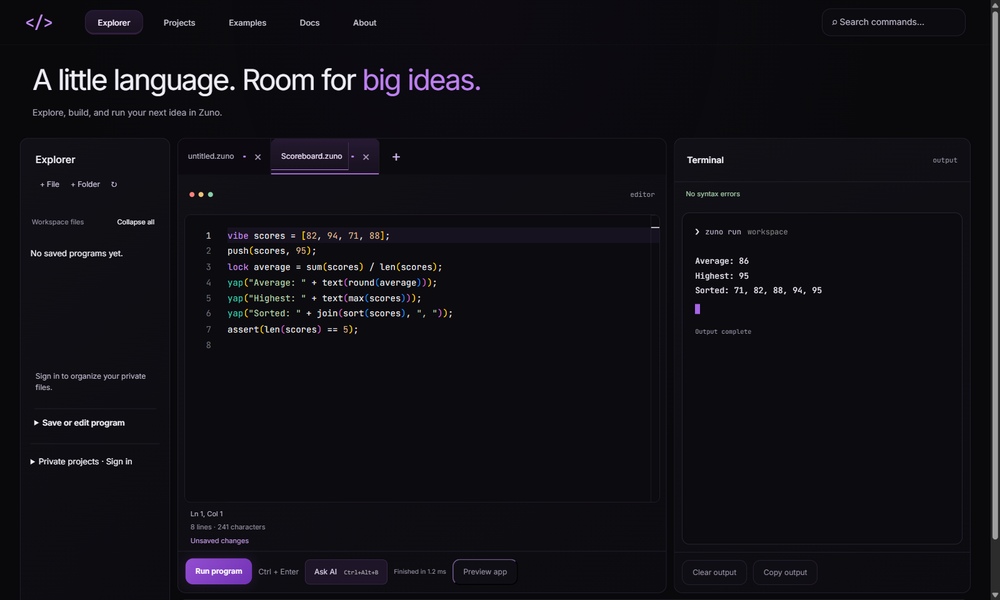

# Zuno

**A small language with room for big ideas.**

Zuno is a programming language you can run in a browser, in your terminal, or from VS Code and Cursor. The syntax has a little personality, but the programs are real: variables, functions, collections, classes, modules, and interactive browser apps run through Zuno's own parser and interpreter.

[Explore Zuno](https://chittranshsharma.github.io/zuno-lang/) · [Language guide](LANGUAGE.md) · [Try the examples](examples/)


## Your first program

```zuno
vibe name = "world";

cook greet(who) {
  yeet "Hello, " + who + "!";
}

yap(greet(name));
```

`vibe` makes a variable, `cook` defines a function, `yeet` returns a value, and `yap` prints it. Prefer familiar words? `let`, `fn`, `return`, and `print` work too. [The language guide](LANGUAGE.md) covers the syntax, standard library, and current limits.

## Meet the studio

The browser studio gives you a Monaco editor with file tabs, syntax highlighting, completion, diagnostics, a terminal, examples, file import/export, and a sandboxed preview for small interactive apps. You can open the AI panel with **Ctrl+Alt+B**, use your own Groq key, ask about selected code, and review proposed edits as a diff before accepting them.



The GitHub Pages site is an introduction and install guide. To use the browser studio with account-backed projects, run the application locally. The static Pages host does not run its Express API or MongoDB. You can save a `.zuno` file to your computer from the local studio. Unsaved browser tabs also recover from that browser's local storage, which is not a backup.

## Run Zuno on your computer

Install [Node.js 20 or newer](https://nodejs.org/) and clone this repository. Then, from the repository folder:

```sh
npm install
npm run install:cli
zuno --version
zuno init my-first-app
cd my-first-app
zuno run main.zuno
```

You can run any `.zuno` file with `zuno file.zuno` or check its syntax with `zuno check file.zuno`. `zuno init` creates a starter file and a VS Code/Cursor build task. The command-line runtime is packaged without the website or database dependencies. It supports local file imports written as `import "./helper.zuno" as helper;`.

Want editor commands and highlighting too? From the repository folder:

```sh
npm run package:extension
code --install-extension dist/zuno-tools.vsix
```

For Cursor, replace `code` with `cursor`. Restart the editor, open a `.zuno` file, then run **Zuno: Run current file** or **Zuno: Check current file** from the command palette. The extension bundles the interpreter, uses Node.js, and does not require MongoDB. It is not a full language server yet.

## Run the browser studio locally

```sh
npm install
npm start
```

Open **http://localhost:3000**. The playground and file import/export work without an account. For private saved projects, start MongoDB locally or set `MONGODB_URI` to your own database before starting the server. The default local database is `mongodb://127.0.0.1:27017/zuno`. Never commit credentials. Accounts and saved projects are served only by the local Express app until you deploy a backend yourself.

## What works today

| Language | Studio and local tools |
| --- | --- |
| Variables and constants, functions and closures, recursion | Monaco editor, file tabs, terminal, diagnostics, completion |
| Conditions, loops, arrays, dictionaries, classes | Examples, command palette, file import/export |
| Named modules and built-in `math`, `strings`, `arrays`, `dict`, `testing` | Sandboxed app preview using Zuno's `ui` module |
| Local `.zuno` file imports through the CLI | CLI, VS Code/Cursor extension, optional private projects and AI |

The browser `ui` module can build counters, calculators, quizzes, and similar small tools. It is not available in terminal runs. Zuno currently has no package registry, native compiler, networking API, async runtime, or general HTML/CSS access. This is a project being built in the open, not a replacement for Python or JavaScript today.

## Explore the project

- [Language reference](LANGUAGE.md) and [working examples](examples/)
- [Browser documentation](docs.html) and [about page](about.html)
- [Editor extension](editor-extension/) and [UI component credits](UI-CREDITS.md)
- `npm test` runs interpreter, CLI, and assistant API tests; `npm run build` builds the studio assets and checks CSS.

If something breaks or a feature feels missing, open an issue with a short `.zuno` example and the result you expected.
